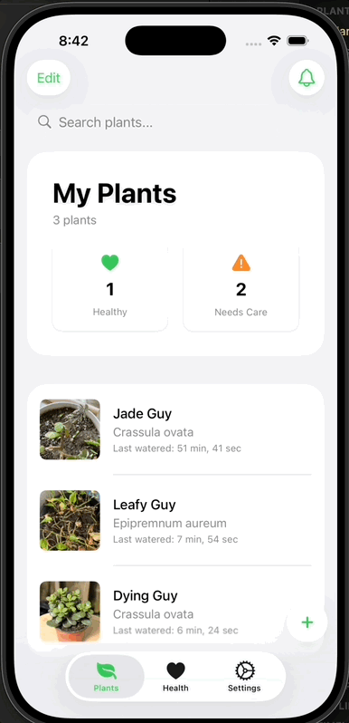

## My plants screen

# Bluetooth sensor integration

## Plant health screen

### Fun animations

___

# PlantPal iOS App
Join the TestFlight: [https://testflight.apple.com/join/NI5fZIlp](https://testflight.apple.com/join/tDFcwZDt)

## Features
- Remember to water your plants with scheduled push notifications
- Identify the species of your plant
- Perform health checks and watch as your plant's health improves over time
- Upload a new photo of your plant each time you water it to build a time lapse of your plant's growth

## API
- Most data is kept on CoreData and persisted with CloudKit
- gRPC server (build in Rust) which essentially wraps Postgres: https://github.com/am7590/PlantPal-GRPC-Postgres
- APNs microservice which dispatches push notifications: https://github.com/am7590/PlantPal-APNs

## Dependencies
- grpc-swift: https://github.com/grpc/grpc-swift
- BRYXBanner: https://github.com/bryx-inc/BRYXBanner

## TODO 
- [ ] Refactor SucculentFormView
- [ ] Cache identification & health check requests
- [ ] Finish trends view; Use real data here
- [ ] Polish UI and rename files for consistency
